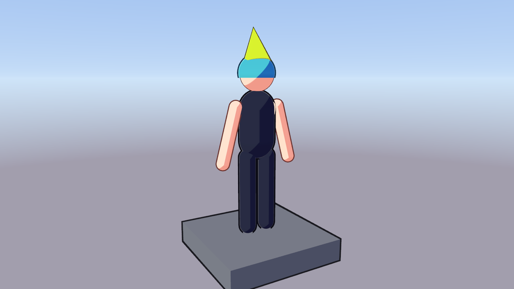

# Sapphire

Sapphire is a Rust game engine built for a stylized 3D anime action game in the vein of Zenless Zone Zero and Wuthering Waves. It targets **macOS, Windows, Linux, iOS and Android**.



**Status: milestone M0 (bring-up).** It has been verified on macOS (Apple Silicon, Metal), on the iOS 26.3 simulator (Metal) and on the Android 16 emulator (Vulkan). Windows and Linux build and pass their tests in CI but haven't run on hardware yet. The sandbox app runs the whole engine path:

1. SDL3 platform layer.
2. Fixed 60 Hz simulation on the engine clocks.
3. Plain-data frame view.
4. wgpu toon renderer (two-tone shading, rim light, inverted-hull outlines, 4× MSAA, reverse-Z).
5. A cooked sample character.

Crash capture, logging, the job system and the asset pipeline are all in place.

## Documents

- [Engine spec](docs/engine-spec.md): what gets built, and how.
- [Research report](reports/Rust%20anime%20action%20game%20engine.md): why Rust, and why these libraries.
- [Conventions](docs/conventions.md): how the code should read.
- [Architecture decisions](docs/adr/).

## Requirements

| For | Install |
|---|---|
| Everything | `rustup`. The toolchain and targets are pinned in `rust-toolchain.toml` and installed automatically. CMake and Ninja are needed to build SDL3 from source. |
| macOS / iOS | Xcode 26 or newer, plus an iOS Simulator runtime (`xcodebuild -downloadPlatform iOS`). |
| Android | JDK 17 (with `JAVA_HOME` set for Gradle) and the Android SDK (`ANDROID_HOME`, or the default `~/Library/Android/sdk`), with NDK r28 or newer, `platforms;android-36`, `build-tools;36.0.0`, `platform-tools` and an emulator image. `cargo xtask run --platform android` boots an AVD named `sapphire_api36` when no device is connected, using `-gpu host` for hardware Vulkan. |
| Linux | The SDL3 build dependencies (X11, Wayland, xkbcommon, udev development headers). |

## Quick start

On any desktop host (Windows, Linux or macOS):

```bash
cargo xtask run --platform desktop
```

On a Mac, for the macOS app bundle, the iOS Simulator or Android:

```bash
cargo xtask run --platform macos
```

```bash
cargo xtask run --platform ios-sim
```

```bash
cargo xtask run --platform android
```

Each command cooks the sample content, builds the sandbox, packages it where the platform needs that, launches it and streams its log here. Arguments after `--` go to the app; for example, `-- --frames 600` exits after 600 presented frames. `--release` builds optimized, and `--dry-run` builds and packages but prints the launch command instead of running it.

- **desktop** runs the build in place against `target/content/desktop/` (through `SAPPHIRE_CONTENT_DIR`). Use it to test on Windows and Linux hardware. `cargo xtask bundle --platform desktop` makes a self-contained `target/desktop/SapphireSandbox/` directory (the executable plus `content/`) to copy to another machine.
- **macos** builds and signs `target/macos/SapphireSandbox.app`, then runs the executable inside it.
- **ios-sim** boots a simulator headless if none is booted; add `--show` to also open Simulator.app.
- **android** uses the connected device, or boots the `sapphire_api36` AVD headless (`-no-window -gpu host`), and returns when the app exits.

**Sandbox controls:**

| Input | Action |
|---|---|
| Drag (mouse or finger), arrow keys, right stick | Orbit |
| Wheel, pinch, triggers | Zoom |
| `Space` or gamepad South | World slow motion |
| `H` or gamepad East | Hitstop |

## Checking visuals and performance without a window

On a desktop, the sandbox has two offscreen modes. Neither opens a window, starts the display stack or takes focus, so they're safe to run while someone is using the machine:

- `--capture <png> [--capture-ticks N]` renders the scene after N fixed ticks and writes a PNG. It's the hook for golden-image tests later.
- `--bench <frames>` runs the per-frame CPU path (fixed step, `Renderer::prepare`, encoding, submit) that many times and logs CPU time and allocations per frame.

Both render at `--size WxH` (default 1920x1080). `xtask run --platform desktop` cooks the content and points the app at it:

```bash
cargo xtask run --platform desktop --release -- --bench 600
```

```bash
cargo xtask run --platform desktop -- --capture out.png --capture-ticks 120 --size 1600x900
```

On mobile, use `xcrun simctl io booted screenshot <png>` (iOS Simulator) or `adb exec-out screencap -p > <png>` (Android) while the app runs.

## Everyday commands

```bash
cargo test-fast
```

```bash
cargo test --workspace
```

```bash
cargo clippy --workspace --all-targets -- -D warnings
```

```bash
cargo xtask check-layers
```

```bash
cargo deny check
```

```bash
cargo xtask content --cook desktop
```

```bash
cargo xtask bundle --platform android --release
```

`cargo test-fast` is the inner loop: unit and integration tests without doctests, which cargo recompiles on every run and which make up most of a full `cargo test --workspace` (CI runs everything). `cargo xtask check-layers` enforces [xtask/layers.toml](xtask/layers.toml): where each crate sits, and which features it may declare. `cargo xtask content` cooks `content/` into `target/content/`, skipping the cook when neither the sources nor the pipeline changed. `cargo xtask bundle` builds the installable package for a platform under `target/<platform>/` without launching it. CI runs xtask as `cargo --locked xtask --locked …`, so neither xtask's build nor the builds it runs may change `Cargo.lock`.

## Layout

```
crates/   runtime crates (they ship), layered L0–L3, see ADR 0001
apps/     shipping binaries (sapphire_sandbox)
tools/    never-shipped tools (sapphire_pipeline)
xtask/    build automation and the layer checker
platform/ per-platform packaging (Info.plist templates, Android Gradle project)
content/  source assets
docs/     spec, conventions, ADRs
```

## Troubleshooting

- **SDL fails to configure on macOS with "unknown architecture arm64e.x1-macos".** The Command Line Tools SDK is newer than the active Xcode's linker. `cargo xtask` sets `SDKROOT` for macOS builds itself. For plain `cargo` builds, run the following first:

  ```bash
  export SDKROOT=$(xcrun --sdk macosx --show-sdk-path)
  ```

  The deployment targets (macOS 14.0, iOS 17.0) come from `.cargo/config.toml`, so every build agrees on them.

- **`cargo xtask bundle` reports a minimum OS that doesn't match Info.plist.** The deployment targets in `.cargo/config.toml` and `platform/{macos,ios}/Info.plist` have drifted apart; change them together. SDL doesn't rebuild when they change, so after changing them run `cargo clean -p sdl3-sys`.

- **SDL for Android still targets the old API level or NDK.** SDL doesn't rebuild when the NDK or `minSdk` changes. Run `cargo clean -p sdl3-sys --target aarch64-linux-android`.

- **`cargo xtask run --platform android` says the AVD is locked.** An emulator for `sapphire_api36` is starting or still running without reaching adb. If none is running, delete the lock file the message names.

- **The macOS window logs `skipping frames reason=Occluded`.** The window isn't visible, for example because it opened on another Space. The loop idles at 30 Hz until the window is visible again.
