<div align="center">

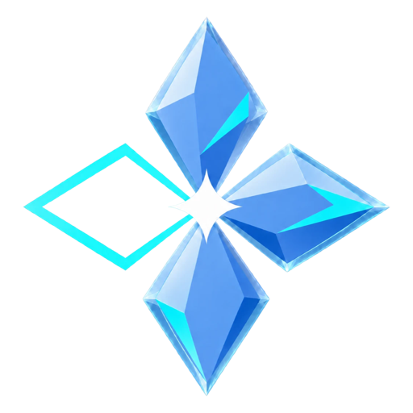

# Sapphire

**A Rust engine for 3D anime-aesthetic action games.**

Anime character shading, authored light, stylized worlds and character action combat,<br>
on macOS, Windows, Linux, iOS and Android.

[](https://github.com/nameless525/sapphire/actions/workflows/ci.yml)
[](https://github.com/nameless525/sapphire/actions/workflows/gpu-tests-warp.yml)
[](CHANGELOG.md)
[](rust-toolchain.toml)
[](LICENSE)

[Features](#features) · [Quick start](#quick-start) · [Architecture](#architecture) · [Status](#status) · [Documentation](#documentation) · [For AI agents](AGENTS.md)

</div>

<br>

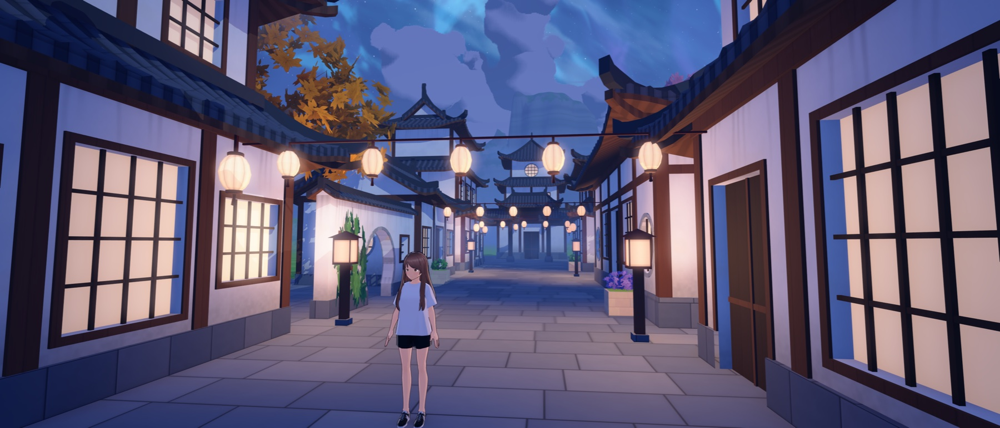

## Features

<table>
<tr>
<td width="50%" valign="top">
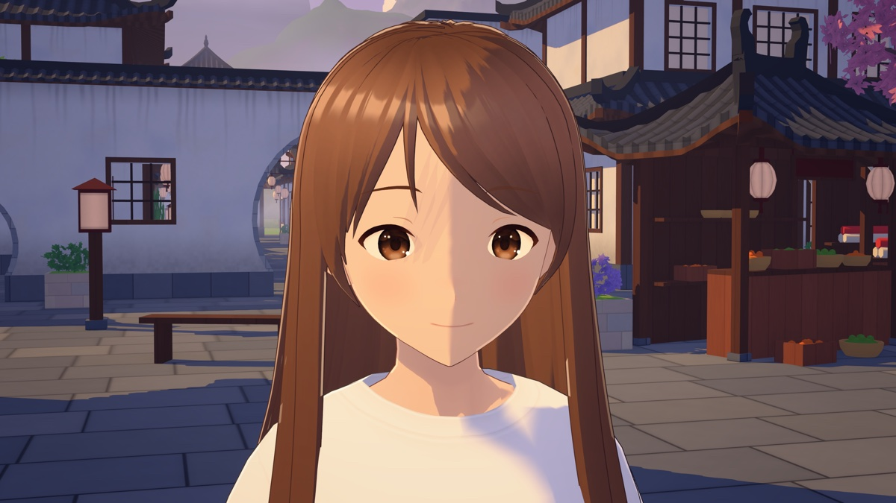
<h3>Anime character shading</h3>
Authored ramps and ILM maps, SDF face shadows, layered eyes, hair highlights, depth-offset rims and stable inverted-hull outlines, under a light rig of the character's own.
</td>
<td width="50%" valign="top">
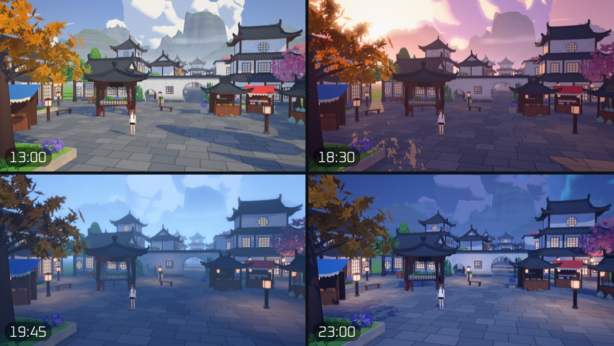
<h3>One key for the whole day</h3>
A single time-of-day key moves the sky, fog, ambient light, shadow tint, the character's light rig and the grade together, from noon to a night under the stars.
</td>
</tr>
<tr>
<td width="50%" valign="top">
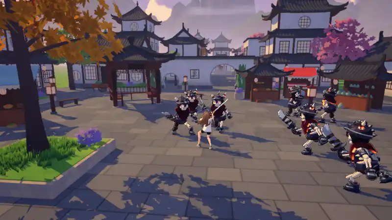
<h3>Character action combat</h3>
Moves are data: hit windows, hitstop, perfect-dodge slow motion, cancels, party swaps, enemies and a boss, with combat screen effects and an ultimate that cuts to its own cinematic.
</td>
<td width="50%" valign="top">
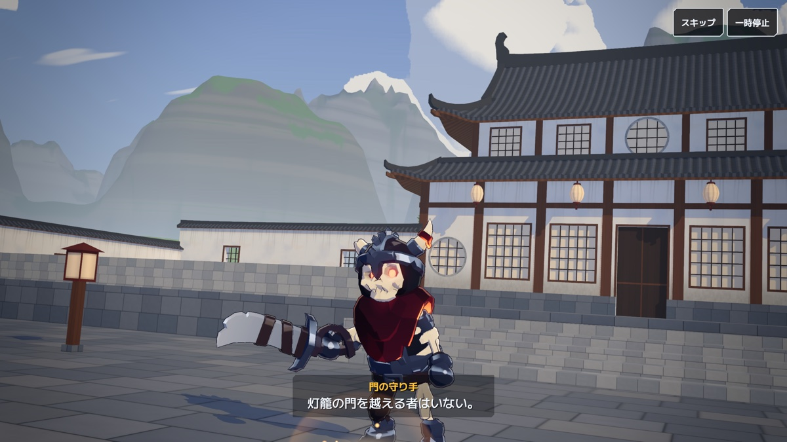
<h3>Cinematics and story</h3>
Timelines, a camera director, dialogue, subtitles and scripted encounters in Luau, all authored as documents: a new enemy, encounter, boss or cutscene needs no Rust.
</td>
</tr>
<tr>
<td width="50%" valign="top">
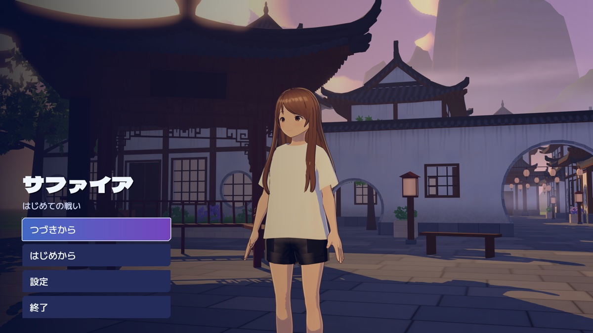
<h3>A whole game around it</h3>
Title, saves, settings with remapping, subtitles, reduced flashes and larger text, in English and Japanese: the Lantern Ward, a slice from the title to the boss.
</td>
<td width="50%" valign="top">
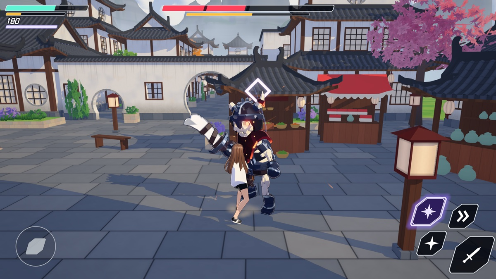
<h3>Made for phones too</h3>
Four quality tiers with a ladder that steps down under heat, ASTC textures, a touch HUD, and pipelines warmed off the frame, so a scripted playthrough draws with zero shader hitches.
</td>
</tr>
</table>

<p align="center">
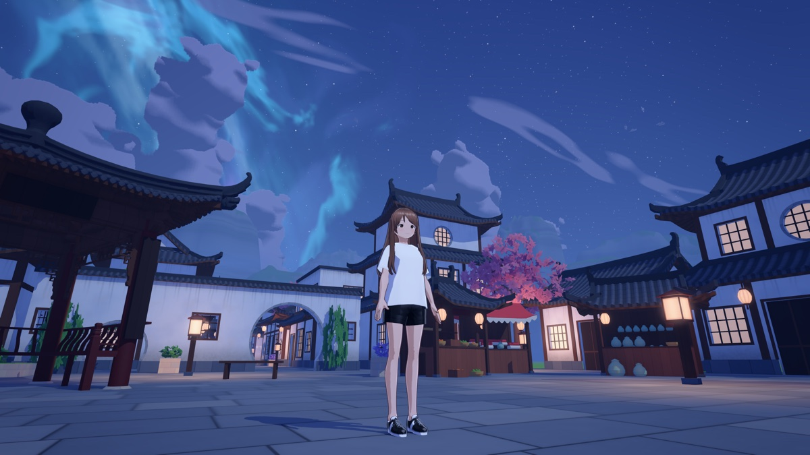
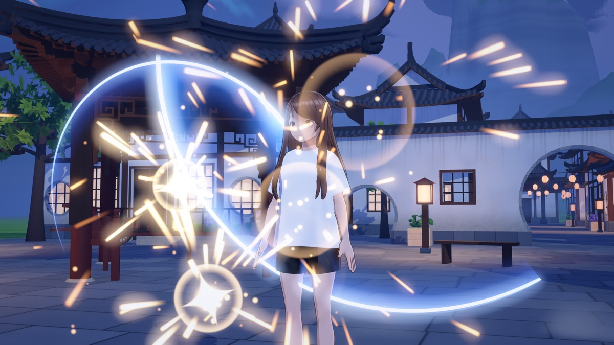
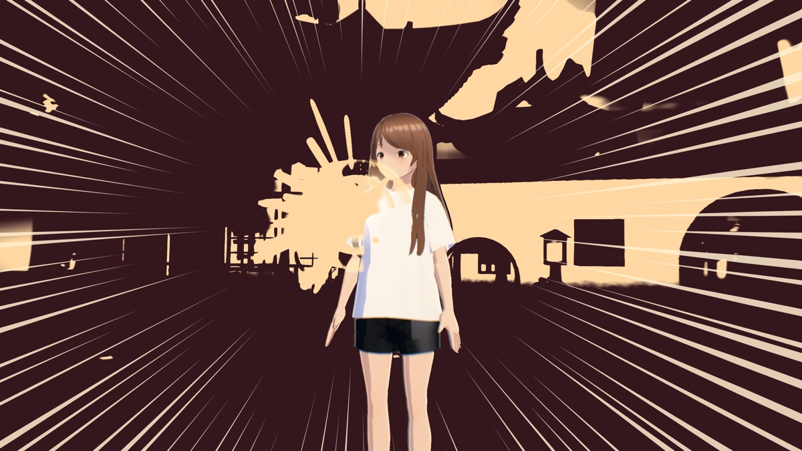
</p>
<p align="center"><sub>Every screenshot here is a frame the engine drew, captured offscreen: <a href="docs/media/README.md">how each was made</a>.</sub></p>

### Under the hood

- **Renderer:** `wgpu` over Metal, Vulkan and DX12, driven by a frame graph. HDR, bloom, a diffusion glow, gradient layers and a custom grade; cascaded shadows, ambient probes and AO; NPR foliage in the wind; TAA on desktop and 4× MSAA on phones.
- **Content:** glTF, VRM 1.0 and FBX, cooked per platform (BC7 or ASTC) through a content-hash cache into packs, loaded asynchronously by asset ID. Signed releases patch themselves by downloading only the blocks that changed.
- **Simulation:** a deterministic fixed 60 Hz step on `bevy_ecs`, whose replays are checked tick by tick on x86-64 and ARM. Our own animation runtime (inertialization, IK, spring bones), physics and navigation, with `kira` for audio.
- **Iteration:** hot reload, and live link to any device: content, materials, time-of-day keys, cvars and shaders change in the running app. A debug overlay, a timeline editor, and playtest builds that bring back marked moments as replays.
- **Proof:** 376 golden scenes compared on three GPU backends and 39 replays, on every pull request; release packages for all five platforms, built nightly.

## Quick start

You need `rustup` (the toolchain is pinned), CMake and Ninja; Xcode for Apple platforms and the Android SDK for Android. [Getting started](docs/getting-started.md) has the details.

```bash
git clone https://github.com/nameless525/sapphire.git && cd sapphire
cargo xtask run --platform desktop --release --app game_app    # play the Lantern Ward
cargo xtask run --platform desktop --release -- --look-dev hero  # the look-dev stage
```

`--platform macos`, `ios-sim` and `android` run the same apps as a macOS bundle, on the iOS Simulator and on Android. Add `--features dev` for the debug overlay, hot reload and live link.

## Architecture

Sixty-one crates in strict layers, which `cargo xtask check-layers` enforces: a crate depends only on the layers below it, and the shipping game never links the development tools.

<p align="center">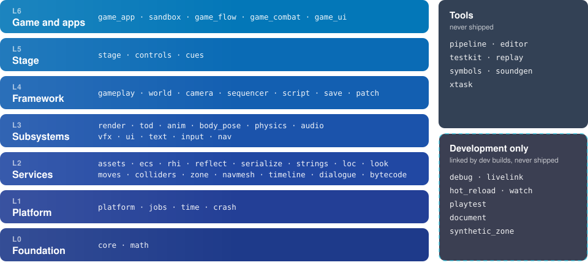</p>

Each frame, the fixed step advances the simulation, then resolves everything the renderer needs into a `FramePacket`; the renderer never reads the world directly. [Architecture](docs/architecture.md) walks through the frame, the content pipeline and the test pyramid.

## Status

**Sapphire 0.1.0** is the first release: the milestones below, all built ([changelog](CHANGELOG.md)). It runs on macOS, the iOS Simulator and the Android emulator; Windows and Linux build, pass their tests and render the golden images in CI. What only a phone, a store account or a person can prove is still owed.

| Milestone | What it built |
|---|---|
| **M1** Data path | The asset pipeline and runtime, the renderer and the anime look, hot reload, live link and golden images |
| **M2** Combat slice | Animation, physics, the combat core, the camera director, enemy AI, audio, VFX, touch controls and the timeline editor |
| **M3** World and tools | Zones, navigation, the sequencer and dialogue, Luau, UI and menus, saves, localization and the editor's documents: the Lantern Ward |
| **M4** Ship readiness | Pipeline warm-up, signed patches, quality tiers and heat, crash symbols, accessibility, store packages and playtests |

The spec's [milestones](docs/engine-spec.md#10-milestones) have each one's exit tests and results, and [the M5 handoff](docs/m5-handoff.md) says where the next one starts.

## Documentation

| | |
|---|---|
| [Getting started](docs/getting-started.md) | Build and run on every platform, the sandbox's controls, the debug overlay, hot reload, captures and goldens |
| [AGENTS.md](AGENTS.md) | The fast orientation for AI agents and new contributors: the map, the rules, the checks |
| [Architecture](docs/architecture.md) | How the crates, the frame and the content pipeline fit together |
| [Docs index](docs/README.md) | Every document, and when to read it |
| [Engine spec](docs/engine-spec.md) | What gets built and how, module by module, with each one's "As built" notes |
| [Changelog](CHANGELOG.md) | What each release holds |
| [Conventions](docs/conventions.md) · [Iteration](docs/development-iteration.md) | How the code reads, and the smallest useful check for each kind of change |

## License

Sapphire is licensed under the [MIT License](LICENSE). Third-party content in [content/third_party/](content/third_party/) keeps its own licenses (CC0, the SIL Open Font License and the VRM Public License 1.0); each folder's `SOURCE.md` gives its author, source and terms.
