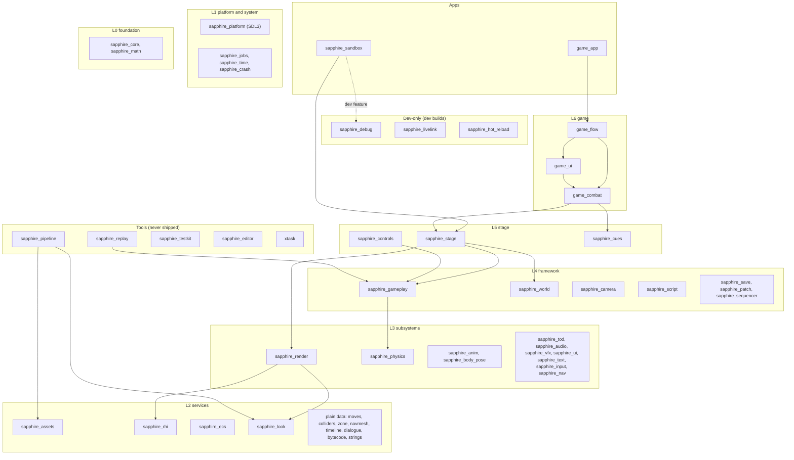
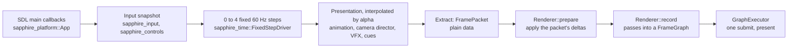
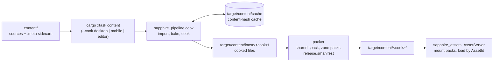

# Architecture overview

A short map of how Sapphire fits together. It isn't the spec: each claim links to the spec section or the code that holds it, and those are what to read before changing anything. [AGENTS.md](../AGENTS.md) has the crate table, the gates and the glossary.

## Crate layers

Crates sit in layers ([spec §4.1](engine-spec.md#41-layer-map), [ADR 0001](adr/0001-crate-layering.md)). A crate depends only on lower layers, plus the same-layer edges [xtask/layers.toml](../xtask/layers.toml) lists under `[allow]`, and `cargo xtask check-layers` enforces it from `cargo metadata` ([xtask/src/layers.rs](../xtask/src/layers.rs)). The diagram shows the layers and a few edges that explain the shape, not every dependency.

What the shape buys:

- **The renderer sees plain values** (rule R4, [spec §4.6](engine-spec.md#46-the-extract-boundary)). `sapphire_render` has no edge to gameplay, the world or time of day. They meet in `sapphire_look`'s plain types, which the renderer draws and time of day resolves into.
- **The simulation is headless.** The crates in `[simulation]` (gameplay, physics, moves, nav, timeline, script and their plain data) may never reach SDL, wgpu, the renderer, the world, animation, input or the platform, so a replay builds fast and runs with no window or GPU ([m2-plan.md](m2-plan.md) §3).
- **The pipeline links no renderer.** `[cooker]` forbids render, world, physics and the mixers in `sapphire_pipeline`'s tree, so a shader edit doesn't rebuild the cooker and a cook reads only plain cooked formats ([spec §4.1's A8 note](engine-spec.md#41-layer-map)).
- **Dev tools enter only through apps.** Dev-only crates (the overlay, hot reload, live link, the playtest recorder) are reached through an app's `dev` or `playtest` feature, so a store build can't link them (rule R8, [spec §1.4](engine-spec.md#14-engine-rules-enforced-in-review-and-ci)).
- **Nothing depends on a tool** (rule R1). Tools run each other as processes: xtask runs the pipeline, the replay runner and the testkit.

## A frame

[Spec §4.2](engine-spec.md#42-frame-lifecycle) is the design; [§4.3](engine-spec.md#43-threading) the threads; [§4.5](engine-spec.md#45-clock-domains) the clocks.

1. **Entry.** SDL's main callbacks drive the app on every platform: an app implements `sapphire_platform::App` ([ADR 0002](adr/0002-platform-entry-and-packaging.md), [crates/sapphire_platform/src/lib.rs](../crates/sapphire_platform/src/lib.rs)). On iOS (a display link) and Android (the choreographer) the engine paces frames to the display itself ([ADR 0003](adr/0003-ios-frame-pacing.md), [ADR 0004](adr/0004-android-frame-pacing.md)).
2. **Fixed steps.** An accumulator turns frame time into 0 to 4 steps at 60 Hz ([crates/sapphire_time/src/lib.rs](../crates/sapphire_time/src/lib.rs)). Time is integer ticks and sub-ticks; each entity reads its owner's clock, which carries hitstop and slow motion.
3. **The stage steps.** A `sapphire_stage::Stage` holds a GPU, cooked content and a `Scene` (the ECS world and its fixed-step systems) ([crates/sapphire_stage/src/lib.rs](../crates/sapphire_stage/src/lib.rs)). What plays on it is the caller's `SceneShow` ([crates/sapphire_stage/src/show.rs](../crates/sapphire_stage/src/show.rs)): the game's `GameShow` (`game_flow`), or a fight (`game_combat::fight::Fight`), which steps the headless `sapphire_gameplay::Simulation` once per fixed step.
4. **Presentation** runs at the frame rate between the last two steps: poses, secondary motion, the camera director, effects, and the cues the step queued, each on its owner's clock.
5. **Extract.** Systems write the frame's `FramePacket`: views, instance deltas, poses, lights, characters' resolved lighting, the resolved look, post values, UI quads, debug lines. It's the only sync point between simulation and rendering, reused from a ring of three ([spec §4.6](engine-spec.md#46-the-extract-boundary)).
6. **Render.** `Renderer::prepare` applies the packet to the persistent GPU scene, `Renderer::record` adds the frame's passes to a `FrameGraph`, and the app runs the graph, which culls unread passes, pools transient textures, records in parallel and submits once ([crates/sapphire_render/src/lib.rs](../crates/sapphire_render/src/lib.rs), [graph.rs](../crates/sapphire_render/src/graph.rs), [spec §5.12](engine-spec.md#512-sapphire_render-l3)).

**Threads** ([spec §4.3](engine-spec.md#43-threading)): the main thread (SDL), one worker pool shared by `bevy_ecs` and the engine (`sapphire_jobs`), a warm-up pool that builds pipelines no frame waits on, an IO thread, the audio backend's callback, and on desktop a separate crash-monitor process.

**Quality** ([spec §3.1](engine-spec.md#31-tiers)): the device picks a tier from [tiers.ron](../crates/sapphire_render/tiers.ron), capped per GPU family by [gpus.ron](../crates/sapphire_render/gpus.ron). Dynamic resolution moves the render scale down to the tier's floor, and a ladder of rungs sheds work in place when the device runs hot.

## The content pipeline

[Spec §5.27](engine-spec.md#527-sapphire_pipeline-tools) is the pipeline, [§5.10](engine-spec.md#510-sapphire_assets-l2) the runtime side.

- **Sources and sidecars.** Everything under `content/` is a source: glTF, FBX and VRM models, images, sounds, fonts, and RON documents (moves, enemies, zones, encounters, scenarios, timelines, dialogues, screens, the game's flow). Each has a `.meta` sidecar holding its asset ID (a GUID) and importer settings ([crates/sapphire_assets/src/lib.rs](../crates/sapphire_assets/src/lib.rs)). Documents name each other by ID or by path under `content/`.
- **Cooking.** `cargo xtask content` builds the pipeline in the `tools` profile and runs its `cook` ([xtask/src/content.rs](../xtask/src/content.rs)). Only assets whose inputs changed cook again. Cooks are per platform: `desktop`, `mobile` (ASTC textures, lighter meshes) and `editor` (the desktop cook plus what only the editor reads). With `--locked`, as CI runs it, a source without a committed sidecar fails the cook.
- **The benchmark's content** is generated, not committed: [bench/](../bench/README.md) holds documents only, and `cargo xtask bench-content --preset ci|budget|double` writes the sources they describe, with their sidecars, into `target/bench/<preset>/sources/` and cooks them there by the same route ([tools/sapphire_pipeline/src/bench.rs](../tools/sapphire_pipeline/src/bench.rs)). Procedural textures (`.ptex.ron`) are rasterized at cook, so a 2K texture set costs a few lines in git. Nothing under `target/bench/` ships.
- **Packs.** Cooked files are packed into `.spack` files, a `shared` pack and one per zone, with a release manifest that a shipping build checks before it mounts a pack ([tools/sapphire_pipeline/src/pack.rs](../tools/sapphire_pipeline/src/pack.rs)).
- **Runtime.** `sapphire_assets` mounts packs and loads assets by ID, memory-mapped and read in place (rkyv archives in `sapphire_serialize`'s envelope). No runtime code names a file path (rule R5). Dev builds swap assets live through hot reload or live link.
- **Reproducible.** A cook gives the same bytes on every machine of one architecture; x86-64 and AArch64 differ only in textures and texture levels. CI's Cooks agree jobs compare the cooks of Linux, Windows and macOS. The cooker's [clippy.toml](../tools/sapphire_pipeline/clippy.toml) bans `std`'s transcendentals in favour of `sapphire_math::det`.
- **Patches.** A later release carries only what the simulation doesn't read: `sapphire_patch` fetches missing blocks by hash and installs beside the current release ([m4-plan.md](m4-plan.md) §3, [m5-handoff.md "A patch"](m5-handoff.md#a-patch)).

## Determinism and replays

The simulation gives one checksum for one set of inputs, per architecture ([spec §5.22](engine-spec.md#522-sapphire_gameplay-l4), [crates/sapphire_gameplay/src/lib.rs](../crates/sapphire_gameplay/src/lib.rs)).

- **Inputs are plain data.** A tick's input is `TickActions`, with a stable byte layout. Live input maps to it through `sapphire_controls`; a replay stores it.
- **What keeps it deterministic:** owner clocks in integer ticks, never the OS clock; `sapphire_math::det` for transcendental math; a seeded `SimRng`; actors walked in `ActorId` order; no `HashMap` or `RandomState`; side effects through fixed queues. Each simulation crate's `clippy.toml` bans the alternatives ([crates/sapphire_gameplay/clippy.toml](../crates/sapphire_gameplay/clippy.toml), [conventions.md](conventions.md)). Luau is built with `-ffp-contract=off` ([.cargo/config.toml](../.cargo/config.toml)).
- **No heap in a step** (rule R6, gate 4). The replay runner installs a counting allocator and fails any step that allocates, naming the tick.
- **Checksums** hash floats by their bits, in ID order, with the tick, the clocks and the RNG. `tests/replays/checksums.aarch64.txt` and `checksums.x86_64.txt` hold what each replay must reach; Linux and Windows share the x86-64 file, which is what proves they agree.
- **Tables.** Each replay stores the `tables_hash` of what it ran on: moves, navmeshes, timelines, scripts, tuning. Those cooked tables must be byte-identical on every OS, since one file holds one hash.
- **A replay** is a scenario (`content/scenarios/*.scenario.ron`) plus an inputs document (`content/inputs/*.inputs.ron`), recorded with `cargo xtask replay --record` into `tests/replays/<name>.sreplay`. `cargo xtask replay` plays every one with no GPU ([tools/sapphire_replay](../tools/sapphire_replay/src/main.rs), [development-iteration.md "Replays"](development-iteration.md#replays)).
- **Outside the checksum:** the camera director, the sequencer's presentation half, cues' effects, sound, and every player setting but the two a step reads (auto-target strength and the timing assist, recorded as replay commands).

## The test pyramid

| Layer | What runs | What it catches | Where |
|---|---|---|---|
| Unit and integration tests | `cargo test --workspace` (`cargo test-fast` locally); GPU or window tests are `#[ignore]`d | Logic, formats, document checks, layering and scan tests | CI Test on Linux, macOS, Windows |
| Replays | `cargo xtask replay` through `sapphire_replay`, no GPU | Any change to simulated state; a step that allocates; OS or architecture divergence | CI Replays on three OSes |
| Golden images | `cargo xtask golden`: the sandbox's offscreen `--capture` per scene in [tests/golden/scenes.ron](../tests/golden/scenes.ron), compared by FLIP (mean, 99th percentile, worst 16×16 tile) | Visual regressions in the renderer, content, UI and the game's screens, per backend | CI Golden images on Metal, lavapipe (3 shards) and WARP (6 shards) |
| GPU tests | `cargo test -p sapphire_render --test gpu -- --ignored`, plus rhi, world, debug and the game's `dev` lib tests | Pass-level GPU behaviour measured from readbacks: cutouts, outlines, shadows, pipelines | CI GPU tests on lavapipe per PR; WARP on `main` |
| App tests | The `dev` sandbox and `game_app` integration tests, offscreen: replays beside the renderer, live tuning, live link, the editor's viewport, `zero_hitches`, `declares_every_setting`, `follows_the_ladder`, zone trips | The whole app path: first-use pipeline builds, hitches, the game's flow, tiers and settings, dev tooling | CI App tests on lavapipe, five lanes |
| Flash tests | `sapphire_testkit flashes` (a WCAG 2.3.1 analyser) over captured fights in default and reduced flashes | Screen effects that flash too much | CI nightly and on dispatch only |
| Packages | `cargo xtask package` for all five platforms, with offline store checks; each desktop package draws its title | Packaging, signing layout, symbols, store validators | `packages.yml` nightly and on packaging PRs |

[spec §9](engine-spec.md#9-quality-gates) lists the gates a change can't merge without; [development-iteration.md](development-iteration.md) the smallest local check for each kind of edit.

## CI workflows

All in [.github/workflows/](../.github/workflows/); [spec §8](engine-spec.md#8-ci) has the history. Only runs on `main` write the Rust caches; pull requests read them.

| Workflow | Runs on | Jobs |
|---|---|---|
| [ci.yml](../.github/workflows/ci.yml) | Every PR, pushes to `main`, nightly on `main` (09:17 UTC), dispatch | **Lint** (fmt, clippy both ways, rustdoc with warnings denied, with and without `sapphire_sandbox/dev`, `check-layers`, cargo-deny, the CI scripts' own tests); **Test** on Linux, macOS, Windows (`cargo test --workspace --locked`); **Replays** on all three; **Prepare golden inputs** (lavapipe, WARP) then **Golden images** (lavapipe 3 shards, WARP 6, Metal 1); **Cooks agree** (Linux and Windows; Linux and macOS); **GPU tests** (lavapipe); **Prepare app tests** then **App tests** (lanes `walk-desktop-low`, `walk-mobile-low`, `walk-mobile-high`, `wave-bench`, `the-rest`); **Mobile build** (iOS device and simulator with `dev`; Android APKs of the sandbox, the game and a `dev` sandbox). Nightly and dispatch add **App tests (flashes)** |
| [gpu-tests-warp.yml](../.github/workflows/gpu-tests-warp.yml) | Pushes to `main` that aren't docs-only, PRs that edit it, dispatch | The GPU tests on WARP (D3D12), too slow for a PR check |
| [packages.yml](../.github/workflows/packages.yml) | Nightly (11:43 UTC), dispatch, PRs touching what packaging reads | Package macOS, iOS, Android, Windows, Linux (Steam Linux Runtime 3.0); draw the Linux package's title on lavapipe; SteamPipe scripts from the desktop packages |
| [privacy.yml](../.github/workflows/privacy.yml) | Every PR, pushes to `main`, tags, dispatch | The privacy guard over the proposed tree, every new commit and the merge commit ([privacy.md](privacy.md)) |
| [capture-experiment.yml](../.github/workflows/capture-experiment.yml) | Dispatch; PRs that edit it | A diagnostic experiment on a CI run's golden inputs; not a gate |
